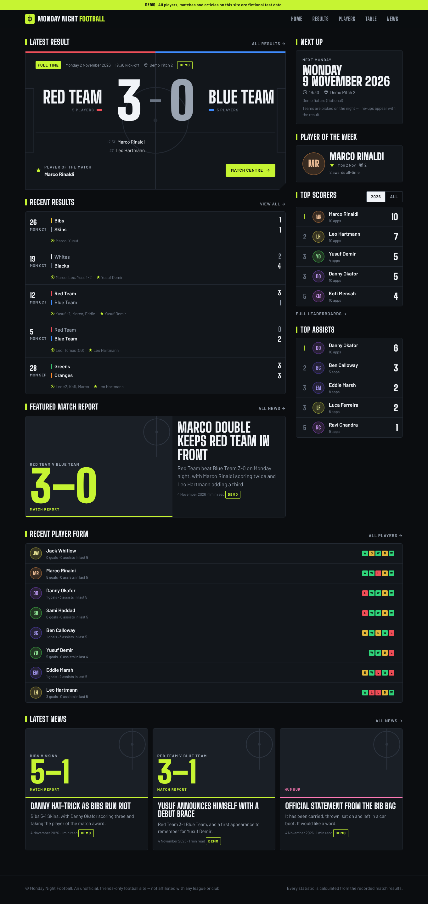
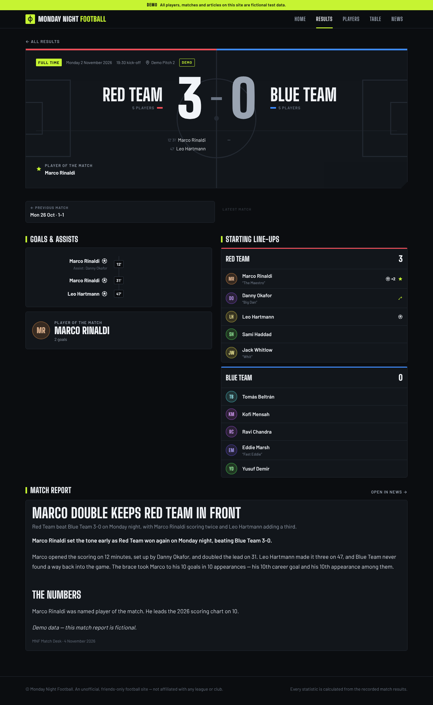
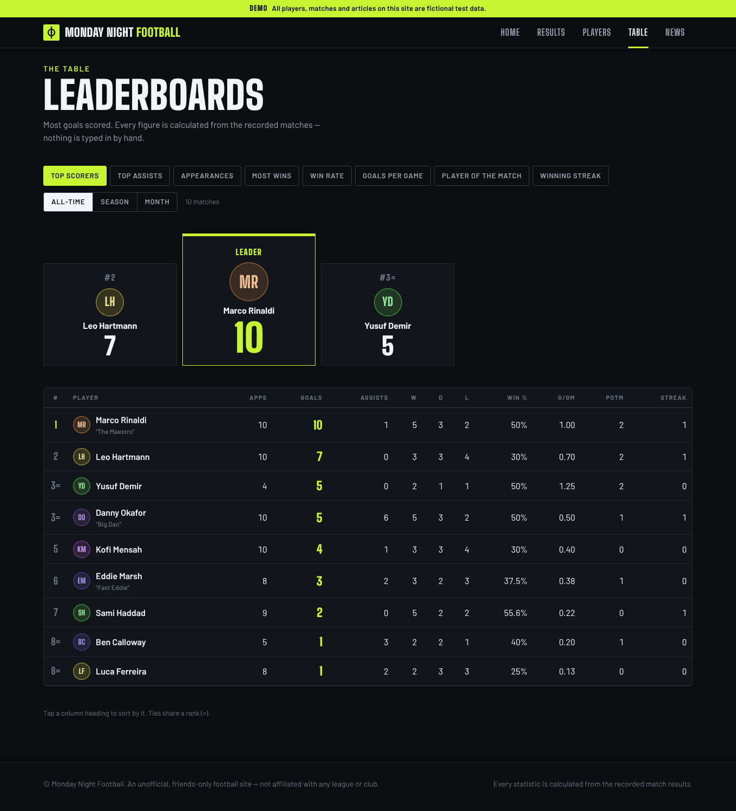
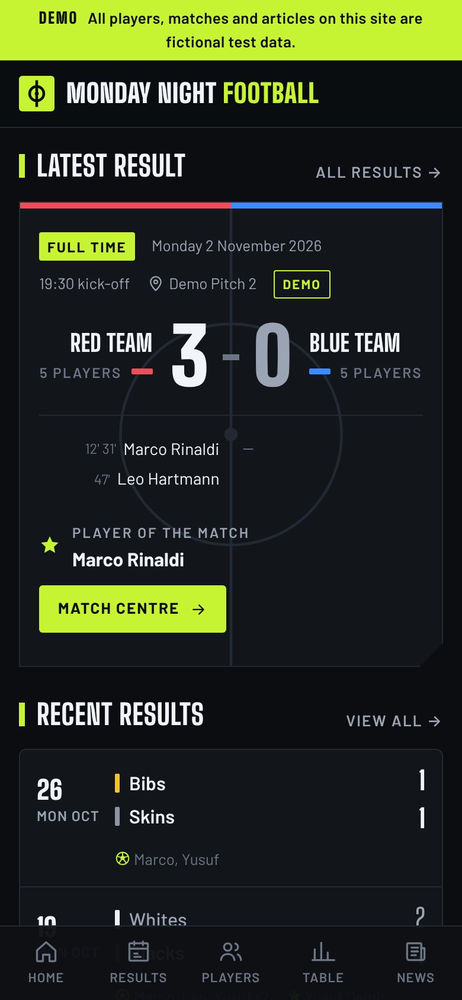
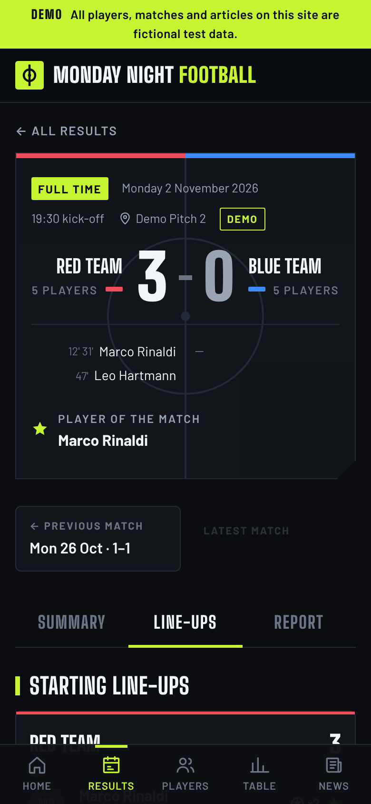
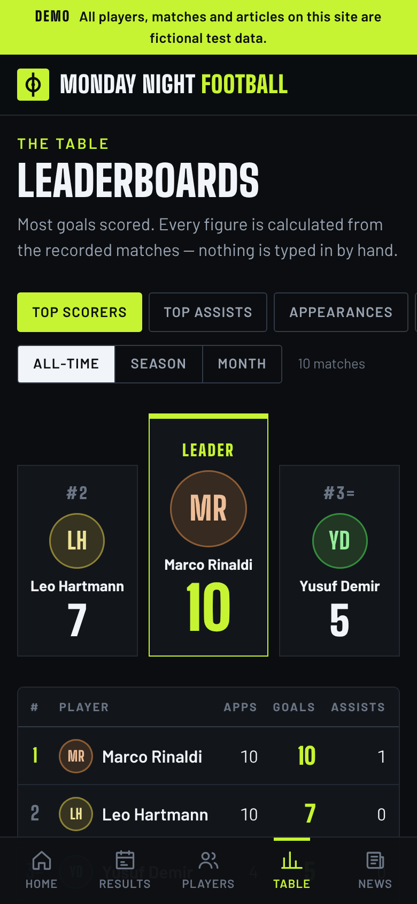

# Monday Night Football

Results, player statistics, leaderboards and news for our Monday night football — a dark, broadcast-style site built on
**Astro 6 + React islands**, **Cloud Firestore** and **Firebase Hosting**, kept up to date by **messaging Claude Code in plain English**.
There is no admin dashboard, no forms and no player login.

<p align="center">
  
</p>
<p align="center">
  
  
</p>
<p align="center">
  
  
  
</p>

*(All data in the screenshots is the fictional demo dataset.)*

## How you use it

You message Claude Code:

> Monday's match finished 3-0. Red Team had Peter, Adam, James, Chris and Arun. Blue Team had Alex, Brownie, Avalon, Josh and Tom.
> Peter scored twice and James once. Adam assisted one. Peter was man of the match. Publish the result and write a match report.

Claude finds the players, **asks** if a name is ambiguous ("Chris B or Chris W?"), refuses inconsistent facts instead of guessing, previews
exactly which statistics will change, writes the match + report in one atomic transaction, and replies with a short summary. The result is
on the live site on the next page load — **no redeploy**. See [`docs/EXAMPLES.md`](docs/EXAMPLES.md) for real output.

## What's in the box

| | |
|---|---|
| **Site** | Home dashboard · match centre (scoreboard, goals with minutes, line-ups, report, prev/next) · results archive with season filters · player directory and profiles · 8 sortable leaderboards (all-time / season / month, minimum-appearance rules) · news with editorial article pages · mobile bottom-tab navigation |
| **Statistics** | One shared engine ([`src/shared/stats.ts`](src/shared/stats.ts)). Nothing is stored; everything is derived from match records, so editing history re-derives everything |
| **Publishing** | `npm run mnf` CLI: dry-run-by-default, name resolution with ambiguity detection, strict validation (scores vs scorers, own goals, unknown scorers, assists), duplicate prevention, atomic writes, optimistic concurrency, audit log + one-command revert |
| **Claude** | [`CLAUDE.md`](CLAUDE.md) operating manual · 10 skills in `.claude/skills/` · Firebase MCP server in `.mcp.json` |
| **Security** | Public reads published data only; clients can't write; least-privilege publisher account; 51 rules tests (mutation-checked) |
| **Demo data** | A complete fictional dataset, flagged and removable with one command |

## Architecture

```
 owner ─ plain English ─► Claude Code ─► mnf CLI ──(Admin SDK, least-privilege service account)──► Cloud Firestore
                                                                                                      │ public read of published docs
                                    GitHub ─ push to main ─► Actions ─► Firebase Hosting ─► browser ◄─┘ (Firestore Lite SDK)
```

* **Static shell + live data.** Match, player and article pages are single static shells; Hosting rewrites `/matches/**` etc. to them and
  they load from Firestore in the browser. That is why a published result needs no deploy.
* **One read per visit.** Every write bumps `settings/site.dataRevision`; browsers cache the data and compare it. Unchanged → 1 Firestore read.
  Changed → refetch. Comfortably inside the free Spark plan.
* **Statistics shared by site and CLI**, so what Claude reports is exactly what visitors see.

## Run it locally

```bash
npm ci
npm run emulators                 # Firestore + Hosting emulators (needs Java 21 for Firestore)
# in a second terminal:
export FIRESTORE_EMULATOR_HOST=127.0.0.1:8080 MNF_PROJECT=demo-mnf
npm run mnf -- demo seed --apply  # fictional data
PUBLIC_FIREBASE_PROJECT_ID=demo-mnf PUBLIC_FIREBASE_API_KEY=x PUBLIC_FIRESTORE_EMULATOR=127.0.0.1:8080 npm run dev
```

## Tests

| Command | What it proves |
|---|---|
| `npm run check` | Astro + TypeScript, strict |
| `npm test` | 100+ unit tests: goals/assists, appearances, W/D/L, **team switching**, **own goals**, **unknown/missing/ambiguous scorers**, **duplicate prevention**, **editing history**, reverts, fact sheets, safe Markdown, bundle hygiene |
| `npm run test:rules` | Against the Firestore emulator: **security rules (51 cases)**, the real store (atomicity, concurrency, audit), the CLI binary, and **Firestore → rendered pages** |
| `npm run test:e2e` | Builds the site, serves it on the Hosting emulator and drives Chromium: publishes / edits / reverts a match **while the site stays byte-identical** and watches the page change; one-read cache check; security probes; mobile layout; demo purge |

## Going live

**Live site: https://tccfootball.web.app** (Firebase project `tccfootball`, free Spark plan). Deploys and publishing are keyless GitHub Actions workflows — see `docs/SETUP.md` §5.

Everything above runs on emulators. Creating the real Firebase project and granting credentials needs your Google account:
**[`docs/SETUP.md`](docs/SETUP.md)** is the exact, ~20 minute checklist. Merge to `main` and GitHub Actions deploys to `https://<project-id>.web.app`.

## Documentation

* [`docs/SETUP.md`](docs/SETUP.md) — Firebase project, rules, credentials, GitHub deploy (the manual steps)
* [`docs/SCHEMA.md`](docs/SCHEMA.md) — every collection and field, invariants, statistics definitions
* [`docs/SECURITY.md`](docs/SECURITY.md) — threat model, what is proven, residual risks
* [`docs/EXAMPLES.md`](docs/EXAMPLES.md) — natural-language workflows with real CLI output
* [`docs/PUBLISHING.md`](docs/PUBLISHING.md) — how publishing works, command reference
* [`CLAUDE.md`](CLAUDE.md) and [`.claude/skills/`](.claude/skills) — what Claude follows

## Layout

```
src/shared/     the schema, validation, name matching, stats, leaderboards, fact sheets (used by site AND CLI)
src/components  React views     src/islands  page entry points     src/lib  data loading, markdown, helpers
src/pages       Astro routes    src/styles   design system
cli/            the publishing CLI (store, services, spec resolution, audit/revert, demo data)
tests/          unit + emulator tests     scripts/  e2e, setup
firestore.rules · firebase.json · .github/workflows/ci-deploy.yml · .mcp.json
```

> Unofficial and not affiliated with any league or club; no third-party branding or assets are used.
